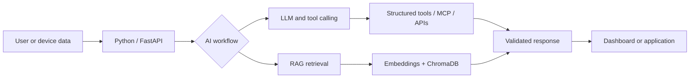

<!-- GitHub profile README — place in the repository named Zeyadelshamy -->

  

  

  

    
    
    
    
  

  
   
  <strong>📍 Germany &nbsp; · &nbsp; 🎓 M.Eng. AI for Smart Sensors &amp; Actuators &nbsp; · &nbsp; 💼 Open to AI engineering opportunities</strong>

---

## 👨‍💻 About Me

I'm an **AI Engineer and master's student** focused on connecting machine learning and language models to **useful software systems**. I build LLM-powered agents, multi-step workflows, retrieval systems, and Python APIs — with an emphasis on structured data, integrations, and clear technical design.

- 🔭 **Current focus:** Agentic AI, tool calling, **MCP / A2A**, RAG, and backend integration.
- 🧪 **Engineering interests:** AI evaluation, reliability, model behavior, and turning prototypes into maintainable applications.
- 🛠️ **Background:** Machine learning, NLP, computer vision, robotics, and embedded AI.
- 🎓 **Education:** M.Eng. at **Technische Hochschule Deggendorf (THD)**; B.Sc. in Artificial Intelligence at **AASTMT**.
- 🧩 **Professional experience:** AI training and evaluation contribution through **Mercor (Senior Writers project)**.

## 🚀 Featured AI Projects

<table>
  <tr>
    <td width="50%" valign="top">
      <h3>🚗 <a href="https://github.com/Zeyadelshamy/DriveNexus-AI">DriveNexus / VehicleConnect AI</a></h3>
      
Automotive agent integration platform for simulated vehicle telemetry, service APIs, and charging recommendations.

      
<code>Python</code> <code>FastAPI</code> <code>MCP</code> <code>A2A</code> <code>Pydantic</code> <code>Docker</code>

      <a href="https://github.com/Zeyadelshamy/DriveNexus-AI">Explore repository →</a>
    </td>
    <td width="50%" valign="top">
      <h3>🏭 <a href="https://github.com/Zeyadelshamy/industrial-ai-agent">Industrial Maintenance AI Agent</a></h3>
      
Tool-enabled assistant that retrieves simulated machine status and interprets temperature, vibration, and pressure data.

      
<code>Python</code> <code>LangGraph</code> <code>LangChain</code> <code>FastAPI</code> <code>Tool Calling</code>

      <a href="https://github.com/Zeyadelshamy/industrial-ai-agent">Explore repository →</a>
    </td>
  </tr>
  <tr>
    <td width="50%" valign="top">
      <h3>📚 <a href="https://github.com/Zeyadelshamy/rag_document_agent">Multi-Document RAG Assistant</a></h3>
      
Local document question-answering across common file formats with chunking, embeddings, semantic retrieval, and citations.

      
<code>LangChain</code> <code>Ollama</code> <code>Llama 3.1</code> <code>ChromaDB</code> <code>Nomic Embeddings</code>

      <a href="https://github.com/Zeyadelshamy/rag_document_agent">Explore repository →</a>
    </td>
    <td width="50%" valign="top">
      <h3>🤖 RAFEQI — Humanoid Assistant Robot</h3>
      
Research and graduation project integrating computer vision, natural language processing, sensors, and autonomous interaction.

      
<code>Python</code> <code>ROS</code> <code>OpenCV</code> <code>TensorFlow</code>

      <a href="https://apc.aast.edu/ojs/index.php/RIMC/article/view/RIMC.2025.02.1.1154">Read publication →</a>
    </td>
  </tr>
</table>

## 🧠 What I Build — From Input to Action

*Conceptual overview of the technologies across my projects; not a literal deployment diagram of a single repository.*

## 🛠️ Technical Toolkit

### 🐍 Programming, Data & ML

      

     

### 🤖 AI Agents, LLMs & NLP

    

    

**Also:** Llama 3.1, prompt engineering, semantic search, embeddings, document parsing, SentencePiece, model evaluation, ROUGE, BERTScore, attention mechanisms, and Seq2Seq models.

### 🔎 Retrieval & Vector Search

  

### 🌐 Backend & Software Engineering

     

**Also:** API integration, input validation, structured tool responses, and exception handling.

### ☁️ Cloud, DevOps & Developer Tools

      

### 🦾 Robotics & Embedded Systems

     

**Also:** sensor fusion, path planning, robot kinematics, embedded C, UART/I²C/SPI, and EasyEDA.

<strong>📦 Additional tools included in my previous profile</strong>

LlamaIndex, AutoGen, FAISS, Flask, Node.js, MySQL, MongoDB, Markdown, LaTeX, Excel, Word, and PowerPoint. These are listed separately from my core AI engineering stack.

## 🎓 Experience, Education & Research

| Area | Details |
|---|---|
| 💼 AI training & evaluation | **Mercor — AI Training & Evaluation Contributor**, Senior Writers project (2026–present) |
| 🎓 Master's | **Technische Hochschule Deggendorf**, M.Eng. Artificial Intelligence for Smart Sensors & Actuators (2025–present) |
| 🎓 Bachelor's | **AASTMT**, B.Sc. Artificial Intelligence — Robotics & Intelligent Systems (2024) |
| 📄 Research | [RAFEQI: Design and Implementation of a Cost-Effective Personal Assistant Robot](https://apc.aast.edu/ojs/index.php/RIMC/article/view/RIMC.2025.02.1.1154) |

<strong>🏅 More academic activities & training</strong>

- AWS Educate / AWS Training — Cloud 101; Machine Learning Foundations.
- Robotics Club — Hardware Committee (AASTMT).
- RoboCup Junior Egypt 2022 — Rescue Line participant.
- ICPC Egypt 2023 — volunteer.
- Artificial Intelligence and Applications — Zewail City of Science and Technology (2023).
- Summer School in Computer Science and AI — Autonomous University of Barcelona (2022).

## 📊 GitHub Activity

  
  

> GitHub statistics depend on third-party services and may occasionally be unavailable. Language statistics describe repository contents, not proficiency.

## 🌍 Languages

🇪🇬 **Arabic:** Native &nbsp; | &nbsp; 🇬🇧 **English:** C1 &nbsp; | &nbsp; 🇩🇪 **German:** A2 (improving)

---

  <strong>Let's connect and build useful AI systems.</strong>
    
  <a href="https://www.linkedin.com/in/zeyad-elshamy-338b01207/">LinkedIn</a> · <a href="mailto:zeyadmagdy205@icloud.com">Email</a> · <a href="https://github.com/Zeyadelshamy">GitHub</a>

